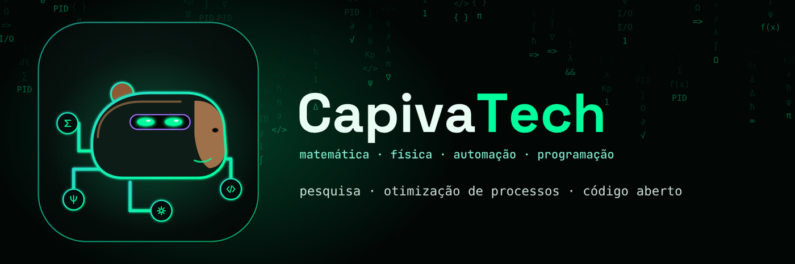
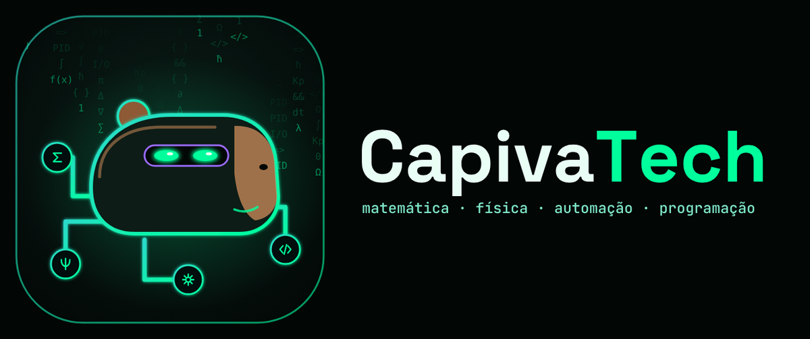

  

  <a href="#english">English</a> · <a href="#português">Português</a> ·
  <a href="https://capivatec.github.io/">Website</a> ·
  <a href="https://www.linkedin.com/company/capivatechjr">LinkedIn</a>

---

## English

<code>&gt; capivatech --mission</code> solve real problems for academia and society

**CapivaTech** is a **non-profit technology collective** created by former Engineering Physics undergraduates at the Federal University of Latin American Integration (**UNILA**), in Foz do Iguaçu, Brazil. It was born as a project in the **Project Development** course and continues today as a hobby: we use **mathematics, physics, automation and programming** to optimize processes and build open solutions for research, the university and the community.

### What we do

| | Area | Examples |
|:-:|---|---|
| **∑** | **Mathematics and optimization** | modelling, numerical methods, statistics, process optimization |
| **ψ** | **Computational physics** | materials simulation, electronic structure, data analysis for research |
| **⚙** | **Automation and control** | PID control, PLCs, robotics, industrial processes |
| **&lt;/&gt;** | **Programming and scientific software** | open tools and applications for laboratories and students |
| **((•))** | **IoT and instrumentation** | sensors, microcontrollers, real-time data collection |
| **∇** | **Artificial intelligence** | machine learning for prediction, classification and decision support |

### How we work

- **Open source:** what we build is available for anyone to study, use and improve.
- **Non-profit:** we work for purpose; our reward is a solved problem.
- **Real problems:** we start from a concrete need of a laboratory, a school or the community.
- **Credit and collaboration:** we work with researchers, students and organizations, crediting every person.

### Projects

| Project | Description |
|---|---|
| [**Weather data platform**](https://github.com/capivatec/CapivaTech) | Solar-powered IoT weather station with ESP8266: wind, temperature, humidity, pressure and rain, with local storage and internet upload. A basis for solar-energy studies. |
| [**BrUMaRe**](https://brunohdmacedo.tech/brumare/) | Free software to analyse electronic-structure calculations (CASTEP, VASP, SIESTA, Quantum ESPRESSO and ORCA). A project by founder Bruno Macedo, developed during his master's. |

### Founders

**Bruno Henrique Dourado Macedo** · **Felipe Camargo** · **Renata Olmedo Benedet**

Have a problem in research, at university or in the community that technology can solve? [Open an issue](https://github.com/capivatec/CapivaTech/issues) or visit [capivatec.github.io](https://capivatec.github.io/).

---

## Português

<code>&gt; capivatech --missao</code> resolver problemas reais da academia e da sociedade

A **CapivaTech** é um **coletivo de tecnologia sem fins lucrativos**, criado por ex-estudantes de graduação em Engenharia Física da Universidade Federal da Integração Latino-Americana (**UNILA**), em Foz do Iguaçu. Nasceu como projeto da disciplina de **Desenvolvimento de Projetos** e continua hoje como hobby: usamos **matemática, física, automação e programação** para otimizar processos e criar soluções abertas para a pesquisa, a universidade e a comunidade.

### O que fazemos

| | Área | Exemplos |
|:-:|---|---|
| **∑** | **Matemática e otimização** | modelagem, métodos numéricos, estatística, otimização de processos |
| **ψ** | **Física computacional** | simulação de materiais, estrutura eletrônica, análise de dados para pesquisa |
| **⚙** | **Automação e controle** | controle PID, CLPs, robótica, processos industriais |
| **&lt;/&gt;** | **Programação e software científico** | ferramentas e aplicações abertas para laboratórios e estudantes |
| **((•))** | **IoT e instrumentação** | sensores, microcontroladores, coleta de dados em tempo real |
| **∇** | **Inteligência artificial** | aprendizado de máquina para previsão, classificação e apoio à decisão |

### Como trabalhamos

- **Código aberto:** o que criamos fica disponível para qualquer pessoa estudar, usar e melhorar.
- **Sem fins lucrativos:** trabalhamos por propósito; nossa recompensa é o problema resolvido.
- **Problemas reais:** partimos de uma necessidade concreta de um laboratório, de uma escola ou da comunidade.
- **Crédito e colaboração:** trabalhamos com pesquisadores, estudantes e organizações, dando crédito a cada pessoa.

### Projetos

| Projeto | Descrição |
|---|---|
| [**Plataforma de dados meteorológicos**](https://github.com/capivatec/CapivaTech) | Estação meteorológica IoT com ESP8266 e energia solar: vento, temperatura, umidade, pressão e chuva, com armazenamento local e envio pela internet. Base para estudos de geração solar. |
| [**BrUMaRe**](https://brunohdmacedo.tech/brumare/) | Software livre para analisar cálculos de estrutura eletrônica (CASTEP, VASP, SIESTA, Quantum ESPRESSO e ORCA). Projeto do fundador Bruno Macedo, desenvolvido no mestrado. |

### Fundadores

**Bruno Henrique Dourado Macedo** · **Felipe Camargo** · **Renata Olmedo Benedet**

Tem um problema na pesquisa, na universidade ou na comunidade que a tecnologia pode resolver? [Abra uma issue](https://github.com/capivatec/CapivaTech/issues) ou visite [capivatec.github.io](https://capivatec.github.io/).

---

  <picture>
    <source media="(prefers-color-scheme: dark)" srcset="assets/logo-escuro.png">
    <source media="(prefers-color-scheme: light)" srcset="assets/logo-claro.png">
    
  </picture>
   
  ∫ ψ ⚙ &lt;/&gt; · non-profit · sem fins lucrativos · open source · código aberto · UNILA

